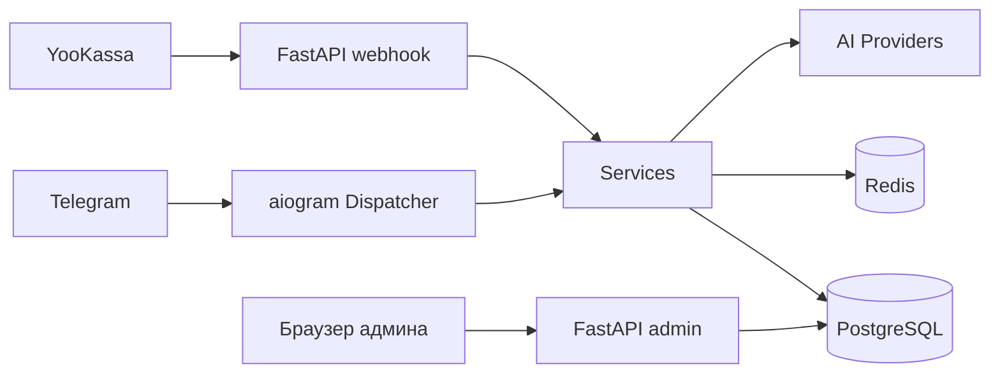

# Neyra — AI-фото бот

Асинхронное Telegram-приложение: пользователь отправляет селфи, выбирает сцену/пресет и получает фото с сохранённым лицом в новой сцене. Включает систему кредитов, подписки, платежи через YooKassa, реферальную программу и собственную административную панель на FastAPI.

## Возможности

- Мультипровайдерная генерация и редактирование изображений (fal.ai, OpenRouter)
- Система кредитов: сгораемые (burn) и вечные пулы
- Подписки с автопродлением через сохранённый платёжный метод
- Платежи YooKassa (webhook + поллинг) с серверной верификацией суммы и валюты
- Платежи через Telegram Stars и CryptoBot
- Админ-панель (FastAPI + Jinja): авторизация, CSRF, rate limit
- Аналитика: когорты, тепловые карты, эксперименты, финансы
- Планировщик публикаций в канал @conturD
- Реферальная система с кэшбэком

## Технологический стек

Backend: Python 3.12, aiogram 3, FastAPI, SQLAlchemy 2 (async), Alembic, PostgreSQL 16, Redis 7.
AI: fal.ai, OpenRouter, OpenAI.
Платежи: YooKassa, Telegram Stars, CryptoBot.
Инфраструктура: Docker Compose, GitHub Actions CI.

## Архитектура

См. `docs/ARCHITECTURE.md`. Упрощённая схема:

## Структура проекта

- `app/` — код приложения
- `migrations/` — миграции Alembic
- `tests/` — тесты pytest
- `docs/` — техническая документация

## Локальный запуск

1. Клонировать репозиторий.
2. `cp .env.example .env`, заполнить значения; для локального запуска `ENV=development`.
3. `docker compose up -d postgres redis`
4. `pip install -r requirements.txt -r requirements-dev.txt`
5. `python main.py` (миграции применяются автоматически)
6. `pytest`

## Конфигурация

См. `.env.example`. Ключевые переменные: `BOT_TOKEN`, `OPENROUTER_API_KEY`, `POSTGRES_*`, `REDIS_URL`, `ADMIN_TOKEN`, `ADMIN_SECRET_KEY`, `ADMIN_BASE_URL`, `YOOKASSA_*`.

`ADMIN_TOKEN` и `ADMIN_SECRET_KEY` должны быть стойкими (>=16 символов) в production; слабые/пустые значения отклоняются.

## Тестирование

`pytest` запускает unit-тесты. Интеграционные тесты требуют PostgreSQL и Redis (см. CI).

## Ограничения

Для полной функциональности нужны внешние API-ключи (OpenRouter, fal.ai, YooKassa). Без них ядро бота запускается в режиме разработки.

## Лицензия

MIT (см. LICENSE).
