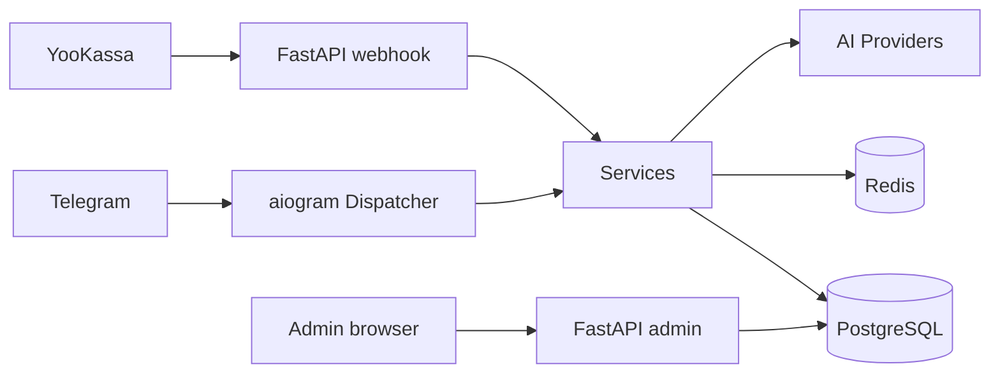

# Neyra — AI Photo Bot

Async Telegram application: users send a selfie, choose a scene/preset, receive a photo with their face preserved in the new scene. Includes credit system, subscriptions, YooKassa payments, referral cashback, and a FastAPI admin dashboard.

## Features

- Multi-provider AI image generation/editing (fal.ai, OpenRouter)
- Credit system with burn (expiring) and eternal pools
- Subscription plans with auto-renewal via saved payment method
- YooKassa payments (webhook + polling fallback) with server-side verification
- Telegram Stars and CryptoBot payments
- Admin dashboard (FastAPI + Jinja) with auth, CSRF, rate limiting
- Analytics: cohorts, heatmaps, experiments, finance
- Channel publishing scheduler for @conturD
- Referral system with cashback

## Tech stack

Backend: Python 3.12, aiogram 3, FastAPI, SQLAlchemy 2 (async), Alembic, PostgreSQL 16, Redis 7.
AI: fal.ai, OpenRouter, OpenAI.
Payments: YooKassa, Telegram Stars, CryptoBot.
Infra: Docker Compose, GitHub Actions CI.

## Architecture

See `docs/ARCHITECTURE.md`. Mermaid diagram:

## Project structure

- `app/` — application code
- `migrations/` — Alembic migrations
- `tests/` — pytest tests
- `scripts/` — operational one-off scripts (not for public use)
- `docs/` — technical documentation

## Local run

1. Clone repo.
2. `cp .env.example .env` and fill values; set `ENV=development` for local.
3. `docker compose up -d postgres redis`
4. `pip install -r requirements.txt -r requirements-dev.txt`
5. `python main.py` (migrations apply automatically)
6. `pytest`

## Configuration

See `.env.example`. Key variables: `BOT_TOKEN`, `OPENROUTER_API_KEY`, `POSTGRES_*`, `REDIS_URL`, `ADMIN_TOKEN`, `ADMIN_SECRET_KEY`, `ADMIN_BASE_URL`, `YOOKASSA_*`.

`ADMIN_TOKEN` and `ADMIN_SECRET_KEY` must be strong (>=16 chars) in production; weak/empty defaults are rejected.

## Testing

`pytest` runs unit tests. Integration tests need PostgreSQL + Redis (see CI).

## Limitations

Requires external API keys (OpenRouter, fal.ai, YooKassa) for full functionality. Without them, core bot still starts in development mode.

## License

MIT (see LICENSE).
