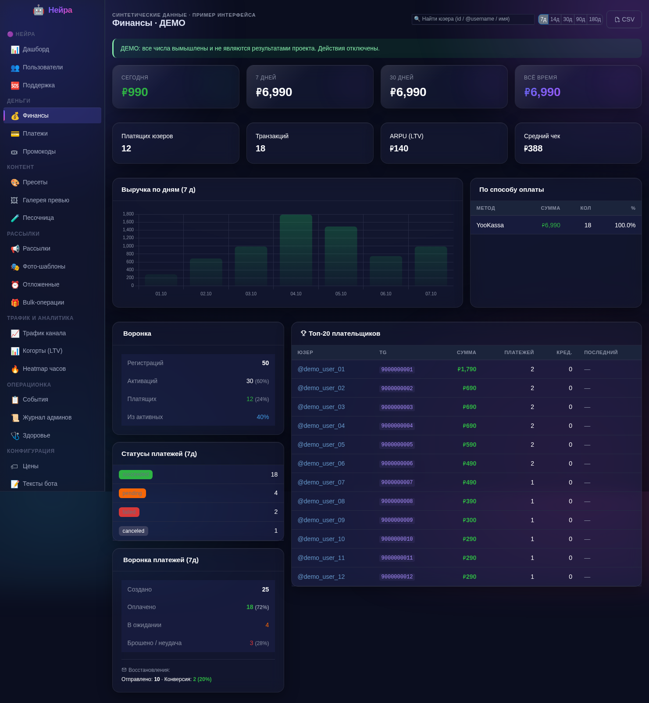
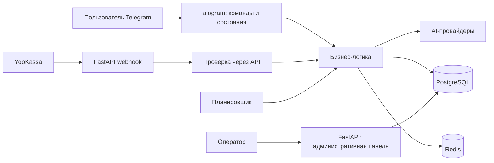

# Neyra — автоматизация AI-сервиса в Telegram

[](https://github.com/zatercivil-stack/aichat-bot/actions/workflows/ci.yml)

Telegram-сервис для генерации и редактирования изображений. Пользователь отправляет селфи, выбирает сцену и получает результат; приложение управляет AI-запросами, кредитами, оплатой и подписками. Оператор работает через административную панель на FastAPI.

**[Открыть бота](https://t.me/NeyraChatBot) · [Кейс автоматизации](docs/CASE_STUDY.md) · [Демонстрация](docs/DEMO.md) · [Архитектура](docs/ARCHITECTURE.md)**

## Зачем этот проект

Проект показывает реализацию полного процесса оказания цифровой услуги: от пользовательского запроса и обращения к внешним API до оплаты, выдачи результата и операционной аналитики. Основные задачи автоматизации:

| Процесс | Что делает система | Где реализовано |
| --- | --- | --- |
| Оказание AI-услуги | Принимает фото и настройки, вызывает AI-провайдера, учитывает кредиты и обрабатывает ошибки | [Обработка изображений](app/handlers/image_edit.py), [AI-интеграции](app/services/image_edit_service.py) |
| Автоматическая выдача покупки | Проверяет платёж через API, начисляет кредиты и активирует подписку; повтор одного платежа не повторяет начисление | [Верификация](app/services/payment_verify.py), [транзакция активации](app/services/payment_processing.py) |
| Повторные коммуникации | Выбирает пользователей для напоминаний об оплате, окончании пробного периода и сроке кредитов | [Оплаты](app/services/payment_recovery.py), [пробный период](app/services/trial_conversion.py), [срок кредитов](app/services/burn_expiry.py) |
| Подписки | Предупреждает об автопродлении, обрабатывает продление и неудачные попытки | [Подписки](app/services/subscription_renewal.py) |
| Работа оператора | Управление пользователями, ценами, пресетами, рассылками; финансовые отчёты и аудит действий | [Админ-панель](app/webserver/admin.py) |

Это демонстрация прикладных компетенций для автоматизации бизнес-процессов и внедрения ИИ: API-интеграции, правила обработки событий, фоновые задачи, надёжность финансовых операций и интерфейс оператора. Измеренный рост выручки или экономия времени в репозитории не заявляются.

## Посмотреть за несколько минут

- Пользовательский сценарий: [@NeyraChatBot](https://t.me/NeyraChatBot), команды `/start`, `/edit`, `/status`, `/sub`. Это внешний сервис, для взаимодействия нужен Telegram; доступность и тарифы могут меняться.
- Панель оператора: [скриншот финансовой панели](docs/assets/finance-demo.png) на синтетических данных; это пример интерфейса, а не показатели работающего сервиса.
- Повторяемая техническая проверка без Telegram и платёжных ключей:

```bash
docker compose -f compose.test.yml run --build --rm test
docker compose -f compose.test.yml down
```

Тестовый контур использует Python 3.12, отдельные PostgreSQL и Redis без опубликованных портов и рабочих данных. Команда применяет все миграции и запускает тесты. Нужны Docker Compose v2+ и интернет для первой сборки.



## Технологии и устройство

Python 3.12 · aiogram 3 · FastAPI/Jinja · SQLAlchemy 2 async · Alembic · PostgreSQL 16 · Redis 7 · Docker Compose · GitHub Actions.

AI-провайдеры: fal.ai, OpenRouter, OpenAI. Платёжные интеграции: YooKassa, Telegram Stars, CryptoBot. Доступность конкретных внешних моделей зависит от провайдеров.



Бот, планировщик и веб-сервер работают в одном процессе. Это упрощает развёртывание; горизонтальное масштабирование потребует отдельного управления фоновыми задачами. Подробнее — [архитектура и ограничения](docs/ARCHITECTURE.md).

## Запуск приложения

```bash
git clone https://github.com/zatercivil-stack/aichat-bot.git
cd aichat-bot
cp .env.example .env
```

Заполните `.env`: реальный `BOT_TOKEN`, ключи нужных AI-провайдеров, пароль БД, `ADMIN_TOKEN` и `ADMIN_SECRET_KEY`. Секреты админки можно создать командой `python -c "import secrets; print(secrets.token_urlsafe(32))"`. Затем:

```bash
docker compose up --build -d
docker compose logs -f bot
```

В контейнерах оставьте `POSTGRES_HOST=postgres` и `REDIS_URL=redis://redis:6379/0`. Миграции применяются при старте. Для production установите `ENV=production` и настройте HTTPS reverse proxy; HTTP-порт приложения опубликован только на `127.0.0.1:8181`. Админка использует Secure-cookie и предназначена для HTTPS. Платёжные webhook и автопродление требуют настройки YooKassa; без ключей соответствующие интеграции недоступны.

Запуск Python на хосте, настройки тестов и генерация демонстрации описаны в [руководстве разработчика](docs/DEVELOPMENT.md).

## Проверки качества

CI проверяет Ruff, форматирование, применение миграций и pytest; отдельно собирает рабочий Docker-образ. Регрессионные тесты покрывают отбор получателей автоматических коммуникаций, начисление и списание кредитов при конкуренции, повторную обработку платежей, откат неудачной активации подписки и безопасность админки.

Внешние AI- и платёжные API в тестах не вызываются: успешная сборка и тесты подтверждают проверяемые сценарии приложения, но не доступность внешних сервисов и качество генераций. См. [безопасность](docs/SECURITY.md) и [связь открытого репозитория с production](docs/PUBLIC_RELEASE.md).

## Структура

- `app/handlers/` — команды Telegram и пользовательские состояния.
- `app/services/` — автоматизация и внешние API.
- `app/database/` — модели и запросы к данным.
- `app/webserver/` — административная панель и webhook.
- `migrations/` — история схемы БД.
- `tests/` — регрессионные проверки; `docs/` — кейс, демонстрация и техническая документация.

Лицензия: [MIT](LICENSE).
